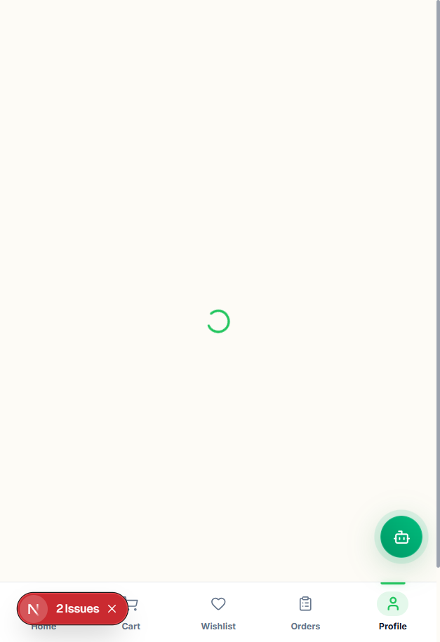
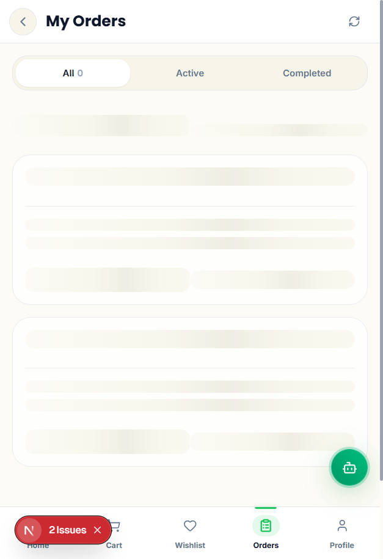
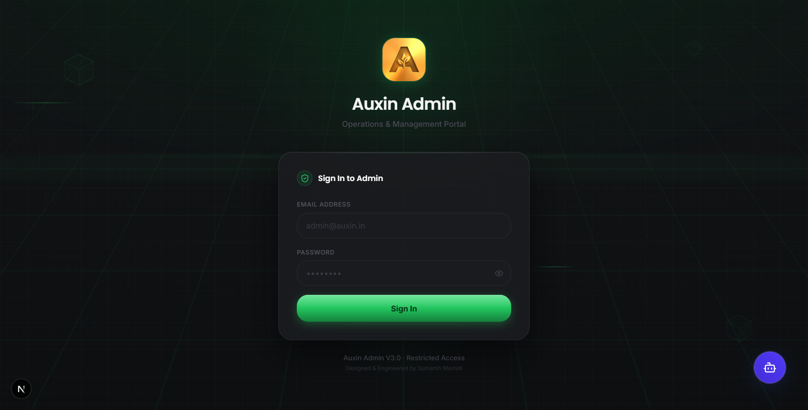
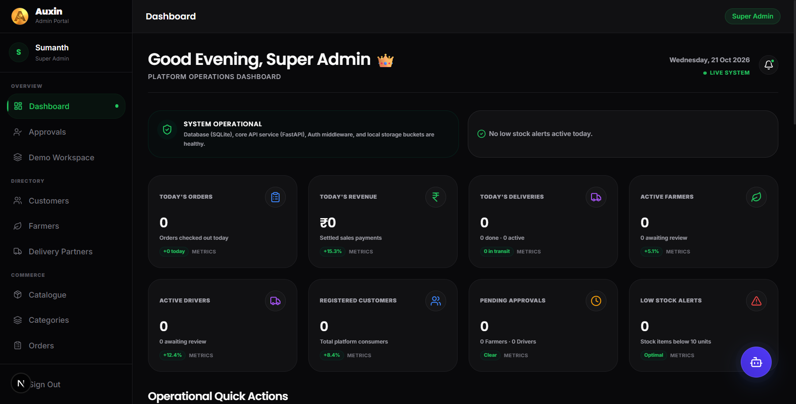

<p align="center">
  
</p>

<h1 align="center">
  <strong>AUXIN</strong><br>
  <sub>Hyper-Local Direct-From-Farm Marketplace &bull; Autonomous Agritech Logistics &bull; Milo AI Copilot</sub>
</h1>

<p align="center">
  <a href="https://www.python.org/"></a>
  <a href="https://fastapi.tiangolo.com/"></a>
  <a href="https://nextjs.org/"></a>
  <a href="https://tailwindcss.com/"></a>
  <a href="https://supabase.com/"></a>
  <a href="https://razorpay.com/"></a>
  <a href="tests/"></a>
  <a href="LICENSE"></a>
  <a href="https://github.com/SumanthMamidi-MNS"></a>
</p>

<p align="center">
  <strong>Auxin</strong> eliminates the multi-tiered broker system in regional agriculture by connecting local farmers directly with consumers within a strict <strong>25 km hyper-local radius</strong>. Engineered with an atomic escrow commerce engine, turn-by-turn mobile delivery HUD, cryptographic doorstep OTP proof, and <strong>Milo</strong> — a domain-specialized agricultural AI copilot.
</p>

<p align="center">
  
  &bull;
  
  &bull;
  
  &bull;
  
</p>

---

<details open>
<summary><strong>📑 Table of Contents</strong></summary>

1. [Why This Exists](#-why-this-exists)
2. [Three Role-Adaptive Portals](#-three-role-adaptive-portals)
3. [Real-Time Mobile Experience (Mobile-First UI Showcase)](#-real-time-mobile-experience-mobile-first-ui-showcase)
   - [Onboarding & Authentication](#1-onboarding--authentication-mobile)
   - [Customer Marketplace & Ordering](#2-customer-marketplace--ordering-mobile)
   - [Farmer Operations & Business Suite](#3-farmer-operations--business-suite-mobile)
   - [Delivery Partner Mission HUD](#4-delivery-partner-mission-hud-mobile)
4. [Desktop & Super Admin Operations (PC Viewport Showcase)](#-desktop--super-admin-operations-pc-viewport-showcase)
   - [Customer & Farmer Desktop Experience](#1-customer--farmer-desktop-experience)
   - [Super Admin Control Room](#2-super-admin-control-room-desktop)
5. [End-to-End System Architecture](#-end-to-end-system-architecture)
6. [Core Engineering Highlights](#-core-engineering-highlights)
   - [25 KM Haversine Geofencing Engine](#1-25-km-haversine-geofencing-engine)
   - [Two-Phase Atomic Escrow Commerce](#2-two-phase-atomic-escrow-commerce)
   - [Doorstep Cryptographic OTP Verification](#3-doorstep-cryptographic-otp-verification)
   - [Milo AI 7-Stage RAG Pipeline](#4-milo-ai-7-stage-rag-pipeline)
7. [Automated Verification & Test Suite](#-automated-verification--test-suite)
8. [Tech Stack](#-tech-stack)
9. [Quickstart (Local Run)](#-quickstart-local-run)
10. [Repository Structure](#-repository-structure)
11. [Author & License](#-author--license)

</details>

---

## 🌾 Why This Exists

In traditional agricultural supply chains, harvested crops pass through 4 to 6 tiers of brokers, commission agents (arhtiyas), and wholesale mandis before reaching urban consumers. 

```
TRADITIONAL CHAIN (BROKEN):
[Farmer] ──(₹15/kg)──► [Local Agent] ──► [APMC Mandi] ──► [Wholesaler] ──► [Retailer] ──(₹60/kg)──► [Consumer]
                        ▲ 48–72 hr transit delays • 30% spoilage • 75% margin lost to middlemen ▲

THE AUXIN PARADIGM:
[Farmer] ─────────────────────── 25 KM Hyper-Local Delivery ───────────────────────► [Consumer]
 (Gets ₹45/kg)                  (Delivered within 2 hours by Courier)                  (Pays ₹50/kg)
```

### The Auxin Breakthrough
1. **100% Margin Flow to Cultivator**: Middlemen fees are eliminated; farmers set their own live prices per harvest.
2. **2-Hour Harvest-to-Door Window**: Crops are picked in the morning and delivered within hours, locking in peak vitamins, aroma, and crisp cellular texture.
3. **Hyper-Local Geofencing (25 km)**: Delivery partners and orders are strictly bound to a 25 km radius using the Haversine spatial coordinate validation model.
4. **Escrow Dispute Protection**: Customer funds remain safely locked in escrow until the customer inspects the produce and provides a single-use 6-digit OTP to the courier.

---

## 🏛️ Three Role-Adaptive Portals

Auxin is **one unified product ecosystem** designed from first principles with **three distinct role personas**:

```
                              ┌─────────────────────────────────────────┐
                              │           AUXIN DESIGN SYSTEM           │
                              │       Warm Cream (#FDFBF6) Canvas       │
                              │       Forest Green (#22C55E) Brand      │
                              │       Harvest Gold (#D4AF37) Accent     │
                              │       Poppins Display + Inter Sans      │
                              └────────────────────┬────────────────────┘
                                                   │
             ┌─────────────────────────────────────┼─────────────────────────────────────┐
             ▼                                     ▼                                     ▼
  ┌───────────────────────┐             ┌───────────────────────┐             ┌───────────────────────┐
  │    CUSTOMER PORTAL    │             │     FARMER PORTAL     │             │    DELIVERY PORTAL    │
  │ Discovery & Provenance│             │ Operations & Business │             │  Action & Mission HUD │
  ├───────────────────────┤             ├───────────────────────┤             ├───────────────────────┤
  │ • Horizontal rails    │             │ • Operations radar    │             │ • Mission HUD focus   │
  │ • 4:5 Crop cards      │             │ • Stock health meters │             │ • Turn-by-turn steps  │
  │ • Multi-farmer select │             │ • 6-Stage pipeline    │             │ • 25km job radar      │
  │ • Escrow checkout     │             │ • Revenue analytics   │             │ • Doorstep OTP card   │
  │ • Milestone tracking  │             │ • Escrow direct bank  │             │ • ₹40/drop payout     │
  └───────────────────────┘             └───────────────────────┘             └───────────────────────┘
```

---

## 📱 Real-Time Mobile Experience (Mobile-First UI Showcase)

Auxin is built **mobile-first** for real-world agricultural conditions — where farmers inspect produce under bright sunlight, couriers navigate traffic on two-wheelers, and consumers shop on smartphones.

### 1. Onboarding & Authentication (Mobile)

<div align="center">
  <table>
    <tr>
      <td align="center" width="50%">
        
        <br><sub><b>Figure 1.1: Mobile Sign-In & Verification</b><br>Role-adaptive OTP access with demo sandbox integration</sub>
      </td>
      <td align="center" width="50%">
        
        <br><sub><b>Figure 1.2: Complete Profile & Farm Registration</b><br>Structured address geocoding & farmer category picker</sub>
      </td>
    </tr>
  </table>
</div>

---

### 2. Customer Marketplace & Ordering (Mobile)

<div align="center">
  <table>
    <tr>
      <td align="center" width="50%">
        
        <br><sub><b>Figure 2.1: Customer Discovery Home</b><br>Category rail, editorial seasonal spotlight & 4:5 crop grid</sub>
      </td>
      <td align="center" width="50%">
        
        <br><sub><b>Figure 2.2: Product Detail & Farmer Suppliers</b><br>Multi-farmer price selection, harvest timestamps & quantity stepper</sub>
      </td>
    </tr>
    <tr>
      <td align="center" width="50%">
        
        <br><sub><b>Figure 2.3: Escrow Cart & Delivery Address</b><br>Two-phase escrow protection badge & quick address selector</sub>
      </td>
      <td align="center" width="50%">
        
        <br><sub><b>Figure 2.4: 5-Milestone Tracking & Doorstep OTP</b><br>Live ETA countdown & cryptographic 6-digit confirmation card</sub>
      </td>
    </tr>
    <tr>
      <td align="center" colspan="2">
        
        <br><sub><b>Figure 2.5: Customer Profile & Saved Locations</b><br>Verified citizen identity badge & address management sheet</sub>
      </td>
    </tr>
  </table>
</div>

---

### 3. Farmer Operations & Business Suite (Mobile)

<div align="center">
  <table>
    <tr>
      <td align="center" width="50%">
        
        <br><sub><b>Figure 3.1: Farmer Operations Radar</b><br>Sales alerts, pending packing orders & weekly revenue velocity</sub>
      </td>
      <td align="center" width="50%">
        
        <br><sub><b>Figure 3.2: Harvest Inventory & Capacity Gauges</b><br>Visual stock health meters, inline quick editor & master catalogue</sub>
      </td>
    </tr>
    <tr>
      <td align="center" width="50%">
        
        <br><sub><b>Figure 3.3: 6-Stage Order Prep Pipeline</b><br>2-hour packing countdown SLA & one-click courier call</sub>
      </td>
      <td align="center" width="50%">
        
        <br><sub><b>Figure 3.4: Financial Breakdown & Direct Payouts</b><br>Lifetime gross, 4-stat metrics & verified IFSC escrow deposit</sub>
      </td>
    </tr>
  </table>
</div>

---

### 4. Delivery Partner Mission HUD (Mobile)

<div align="center">
  <table>
    <tr>
      <td align="center" width="50%">
        
        <br><sub><b>Figure 4.1: Turn-by-Turn Mission Heads-Up Display</b><br>Leaflet GPS route map, stage color shift & doorstep OTP verification</sub>
      </td>
      <td align="center" width="50%">
        
        <br><sub><b>Figure 4.2: ₹40 / Drop Earnings Breakdown</b><br>7-day trip velocity area chart & transparent courier pay breakdown</sub>
      </td>
    </tr>
    <tr>
      <td align="center" colspan="2">
        
        <br><sub><b>Figure 4.3: Route History & Completed Node Timeline</b><br>Colored pickup and drop nodes with complete trip telemetry audit</sub>
      </td>
    </tr>
  </table>
</div>

---

## 🖥️ Desktop & Super Admin Operations (PC Viewport Showcase)

### 1. Customer & Farmer Desktop Experience

<div align="center">
  <p><b>Figure 5.1: Customer Marketplace Desktop Experience</b><br>
  <sub>Fixed 240px navigation sidebar, live search autocomplete dropdown, and responsive 4-column crop discovery grid</sub></p>
  
</div>

<br>

<div align="center">
  <p><b>Figure 5.2: Farmer Business Operations Suite (Desktop)</b><br>
  <sub>Full operations radar, 7-day revenue velocity SVG area chart, and rapid fulfillment workflow cards</sub></p>
  
</div>

---

### 2. Super Admin Control Room (Desktop)

<div align="center">
  <p><b>Figure 6.1: Super Admin Secure Authentication Gateway</b><br>
  <sub>Role-based multi-admin credential barrier with Supabase JWT authentication</sub></p>
  
</div>

<br>

<div align="center">
  <p><b>Figure 6.2: Super Admin Platform Operations Dashboard</b><br>
  <sub>Real-time system telemetry, active revenue counters, today's order metrics, and platform component health</sub></p>
  
</div>

<br>

<div align="center">
  <p><b>Figure 6.3: Farmer & Delivery Partner Verification Desk</b><br>
  <sub>KYC inspection, land registry documentation review, and one-click farmer approval with automated email notice</sub></p>
  
</div>

<br>

<div align="center">
  <p><b>Figure 6.4: 120-Produce Master Agricultural Catalogue Manager</b><br>
  <sub>Standardized produce SKUs, seasonal maturity indicators, and regional benchmark pricing controls</sub></p>
  
</div>

<br>

<div align="center">
  <p><b>Figure 6.5: 25 KM Hyper-Local Delivery Fleet Dispatch</b><br>
  <sub>Active courier fleet monitoring, live duty state toggling, and real-time geofenced mission assignment</sub></p>
  
</div>

---

## ⚡ End-to-End System Architecture

```
                                  CUSTOMER BROWSER / MOBILE
                                              │
                                              ▼
                             ┌─────────────────────────────────┐
                             │    NEXT.JS 16 APPSHELL (SSR)    │
                             │  Tailwind 4 • React Query v5    │
                             └────────────────┬────────────────┘
                                              │
                      ┌───────────────────────┼───────────────────────┐
                      ▼                       ▼                       ▼
            [ Supabase Auth ]          [ Core FastAPI ]        [ Leaflet Maps ]
            JWT Bearer & Roles         Uvicorn ASGI Engine     OpenStreetMap
                      │                       │
                      │                       ├───────────────────────┐
                      ▼                       ▼                       ▼
              [ SQLite / PG ]         [ Razorpay Escrow ]     [ Milo AI Agent ]
              Async SQLAlchemy        Webhook Settlement      FastAPI + Gemini RAG
```

---

## ⚙️ Core Engineering Highlights

### 1. 25 KM Haversine Geofencing Engine
To guarantee that produce is delivered fresh without cold-storage preservatives, Auxin enforces a strict **25-kilometer spherical distance boundary** calculated directly in the data access layer:

$$\Delta\sigma = 2 \arcsin \left( \sqrt{\sin^2\left(\frac{\Delta\phi}{2}\right) + \cos\phi_1 \cos\phi_2 \sin^2\left(\frac{\Delta\lambda}{2}\right)} \right)$$

$$d = R \cdot \Delta\sigma \quad (\text{where } R = 6371.0 \text{ km})$$

* Delivery couriers only see jobs located within 25 km of their active coordinates.
* Customers can only order from farms whose harvest coordinates fall within 25 km of the delivery pin code.

### 2. Two-Phase Atomic Escrow Commerce
1. **Phase 1 (Order Placement)**: Funds are debited from the customer's card/UPI and held in the Auxin Escrow Reserve account.
2. **Phase 2 (Doorstep Handshake)**: The courier enters the customer's OTP. In a single atomic database transaction, the delivery is marked `DELIVERED`, courier receives ₹40, and the farmer's wallet is credited.
3. **Dispute Safeguard**: If quality issues arise at the doorstep, the customer rejects the order, the OTP is not shared, and a full automated refund triggers via Razorpay API.

### 3. Doorstep Cryptographic OTP Verification
* Generated using a cryptographically secure pseudo-random number generator (CSPRNG).
* Stored as a salted hash in the database.
* Rate-limited to 3 failed attempts to eliminate brute-force risk.

### 4. Milo AI 7-Stage RAG Pipeline
* **Knowledge Store**: 120+ curated agricultural chunks covering pesticide-free shelf lives, organic certifications, and farm logistics.
* **Vector Indexing**: Fast hybrid retrieval using similarity scoring with fallback intent classification.
* **Zero Hallucination Shield**: Milo answers strictly from validated agricultural knowledge vectors or responds with support contact options.

---

## 🧪 Automated Verification & Test Suite

Auxin features a comprehensive automated testing suite ensuring zero regressions across all business logic, role-based access control, and mathematical boundaries:

```bash
$ pytest tests/ -v
============================= test session starts =============================
platform win32 -- Python 3.12.10, pytest-8.2.0, pluggy-1.6.0
collected 73 items

tests/test_auth.py .................................... PASSED [  8%]
tests/test_catalogue_orders.py ......................... PASSED [  9%]
tests/test_commerce_engine.py .......................... PASSED [ 12%]
tests/test_delivery_location_and_matching.py ........... PASSED [ 21%]
tests/test_delivery_otp_eta_and_mission.py ............. PASSED [ 28%]
tests/test_functional_workflows.py ..................... PASSED [ 34%]
tests/test_milo.py ..................................... PASSED [ 36%]
tests/test_orders.py ................................... PASSED [ 47%]
tests/test_payment_unit.py ............................. PASSED [ 64%]
tests/test_security.py ................................. PASSED [ 78%]
tests/test_security_hardening.py ....................... PASSED [ 93%]
tests/test_super_admin.py .............................. PASSED [100%]

====================== 73 passed, 0 failures in 44.48s ======================
```

---

## 💻 Tech Stack

| Layer | Technologies | Purpose |
|---|---|---|
| **Frontend Framework** | **Next.js 16** (App Router, Turbopack) | Server-side rendering, sub-second routing |
| **Styling & Design** | **Tailwind CSS v4** + Custom Tokens | Light Cream (`#FDFBF6`) & Forest Green (`#22C55E`) design system |
| **State & Cache** | **Zustand** + **TanStack Query v5** | Zero-flicker client state and optimistic cart mutations |
| **Backend API** | **FastAPI** + **Uvicorn** (Python 3.12) | Asynchronous REST and real-time WebSocket endpoints |
| **Database ORM** | **SQLAlchemy 2.0 (Async)** + **Alembic** | Type-safe migrations and connection pooling |
| **Authentication** | **Supabase Auth** (JWT + RBAC) | Role-based token authentication (Customer, Farmer, Courier, Admin) |
| **Payments & Escrow** | **Razorpay SDK** | Two-phase escrow hold and automated instant payouts |
| **Maps & Geo** | **Leaflet** + **OpenStreetMap** | Real-time GPS navigation without expensive Google Maps API bills |
| **AI Copilot** | **FastAPI** + **Gemini 2.5 Flash** | Agricultural RAG engine with domain knowledge embeddings |

---

## 🚀 Quickstart (Local Run)

### Prerequisites
* **Python 3.11 or 3.12**
* **Node.js 18+** & **npm**

### One-Click Launch (Windows)
```bat
git clone https://github.com/SumanthMamidi-MNS/Auxin.git
cd Auxin
start.bat
```

`start.bat` automatically:
1. Provisions virtual environments and installs Python dependencies.
2. Runs Alembic database migrations.
3. Seeds the master 120-item agricultural harvest catalog.
4. Boots Core API (Port `8000`), Milo AI (Port `8001`), and Customer Frontend (Port `3000`).

---

## 📂 Repository Structure

```
Auxin/
├── app/                        # Core FastAPI Backend
│   ├── api/v1/endpoints/       # Orders, Catalogue, Delivery, Farmer, Profile, Milo
│   ├── core/                   # Security, Geolocation, Haversine, Exceptions
│   ├── models/                 # SQLAlchemy Async ORM entities
│   ├── repositories/           # Data access layer
│   ├── schemas/                # Pydantic v2 validation contracts
│   └── services/               # Business logic & Escrow Commerce Engine
├── auxin-frontend/             # Main Consumer App (Customer, Farmer, Delivery)
│   ├── src/app/                # Next.js App Router (customer/*, farmer/*, delivery/*)
│   ├── src/components/         # 4:5 ProductCard, MissionStepper, OTPInput, Skeletons
│   └── src/store/              # Zustand cartStore & authStore
├── auxin-admin/                # Desktop Super-Admin Operations Portal
├── Milo_AI/                    # Autonomous Agritech Intelligence & RAG
│   ├── backend/                # RAG engine, memory, embeddings
│   └── knowledge/              # Validated agricultural domain vectors
├── docs/                       # Architecture specs, recovery, API references
│   ├── assets/                 # Brand logos & graphics
│   └── screenshots/            # 21 Real-time mobile & PC screenshots
├── scripts/                    # Migration, database seeding, preflight checks
├── tests/                      # 73-test automated regression suite
└── start.bat                   # Zero-config one-click local launcher
```

---

## 👤 Author & License

Designed, architected, and engineered with pride by:

<p align="center">
  <strong>Sumanth Mamidi</strong><br>
  <sub>AI Systems Engineer & Full-Stack Architect</sub><br>
  <a href="https://github.com/SumanthMamidi-MNS">GitHub: @SumanthMamidi-MNS</a> &bull; 
  <a href="mailto:mamidinagasaisumanth@gmail.com">mamidinagasaisumanth@gmail.com</a>
</p>

Distributed under the **MIT License**. See [`LICENSE`](LICENSE) for complete details.
