<p align="center">
  <a href="https://auxin-landing.vercel.app/">
    
  </a>
</p>

<h1 align="center">
  <strong>AUXIN</strong><br>
  <sub>Autonomous Agritech Logistics &bull; Hyper-Local Direct-From-Farm Marketplace &bull; Milo AI Copilot</sub>
</h1>

<p align="center">
  <a href="https://auxin-landing.vercel.app/"></a>
  <a href="https://github.com/SumanthMamidi-MNS/Auxin"></a>
  <a href="https://www.python.org/"></a>
  <a href="https://fastapi.tiangolo.com/"></a>
  <a href="https://nextjs.org/"></a>
  <a href="https://tailwindcss.com/"></a>
  <a href="https://supabase.com/"></a>
  <a href="https://razorpay.com/"></a>
  <a href="tests/"></a>
  <a href="LICENSE"></a>
  <a href="https://github.com/SumanthMamidi-MNS"></a>
</p>

<p align="center">
  <strong>Auxin</strong> eliminates the predatory multi-tiered broker system in regional agriculture by connecting local farmers directly with consumers within a strict <strong>25 km hyper-local radius</strong>. Engineered with an atomic escrow commerce engine, turn-by-turn mobile delivery HUD, cryptographic doorstep OTP proof, and <strong>Milo</strong> — a domain-specialized agricultural AI copilot.
</p>

<p align="center">
  <a href="https://auxin-landing.vercel.app/"><strong>Explore Live Landing Page &rarr;</strong></a> &nbsp;&bull;&nbsp;
  <a href="#four-role-adaptive-portals-design-system"><strong>Explore 4 Portals</strong></a> &nbsp;&bull;&nbsp;
  <a href="#panoramic-ecosystem-showcase"><strong>UI Showcase</strong></a> &nbsp;&bull;&nbsp;
  <a href="#end-to-end-system-architecture"><strong>Architecture</strong></a> &nbsp;&bull;&nbsp;
  <a href="#core-engineering-highlights-technical-interview-deep-dive"><strong>Engineering Deep-Dive</strong></a> &nbsp;&bull;&nbsp;
  <a href="#quickstart-local-run"><strong>Quickstart</strong></a>
</p>

<p align="center">
  
  &bull;
  
  &bull;
  
  &bull;
  
  &bull;
  
</p>

---

<details open>
<summary><strong>📑 Table of Contents (Click to Expand / Collapse)</strong></summary>

1. [Why Auxin Exists (The Agricultural Paradigm Shift)](#why-auxin-exists-the-agricultural-paradigm-shift)
2. [Four Role-Adaptive Portals & Design System](#four-role-adaptive-portals-design-system)
3. [Panoramic Ecosystem Showcase](#panoramic-ecosystem-showcase)
4. [Real-Time Mobile Experience (Field Applications)](#real-time-mobile-experience-field-applications)
   - [Customer Marketplace & Escrow Checkout](#1-customer-marketplace-escrow-checkout-mobile)
   - [Farmer Operations Suite & Business Radar](#2-farmer-operations-suite-business-radar-mobile)
   - [Delivery Partner Mission HUD](#3-delivery-partner-mission-hud-mobile)
5. [Desktop & Super Admin Operations (PC Viewport Showcase)](#desktop-super-admin-operations-pc-viewport-showcase)
   - [Customer & Farmer Desktop Web Experience](#1-customer-farmer-desktop-web-experience)
   - [Super Admin Command Control Room](#2-super-admin-command-control-room-desktop)
6. [Milo AI — Domain Agricultural Copilot](#milo-ai-domain-agricultural-copilot)
7. [Core Engineering Highlights (Technical Interview Deep-Dive)](#core-engineering-highlights-technical-interview-deep-dive)
   - [25 KM Haversine Geofencing Engine](#1-25-km-haversine-geofencing-engine)
   - [Two-Phase Atomic Escrow Commerce Engine](#2-two-phase-atomic-escrow-commerce-engine)
   - [Doorstep Cryptographic OTP Verification](#3-doorstep-cryptographic-otp-verification)
   - [Role-Based Access Control (RBAC) & Security Architecture](#4-role-based-access-control-rbac-security-architecture)
8. [End-to-End System Architecture](#end-to-end-system-architecture)
9. [Automated Verification & Test Suite](#automated-verification-test-suite)
10. [Comprehensive Tech Stack Matrix](#comprehensive-tech-stack-matrix)
11. [Quickstart (Local Run)](#quickstart-local-run)
12. [Repository Structure Map](#repository-structure-map)
13. [Author & License](#author-license)

</details>

---

## 🌾 Why Auxin Exists (The Agricultural Paradigm Shift)

In traditional agricultural supply chains across South Asia, freshly harvested produce passes through 4 to 6 tiers of middlemen, commission agents (*arhtiyas*), and wholesale mandis before reaching urban households.

```
TRADITIONAL SUPPLY CHAIN (BROKEN & PREDATORY):
[Cultivator] ──(₹15/kg)──► [Village Agent] ──► [APMC Mandi] ──► [Wholesaler] ──► [Sub-Broker] ──► [Retailer] ──(₹60/kg)──► [Consumer]
                             ▲ 48–72 hr transit delays • 30% spoilage • 75% margin lost to intermediaries ▲

THE AUXIN PARADIGM (DIRECT & AUTONOMOUS):
[Cultivator] ────────────────────────── 25 KM Hyper-Local Delivery ──────────────────────────► [Consumer]
 (Receives ₹45/kg)                      (Delivered in 2 Hours by Courier for ₹40/drop)         (Pays ₹50/kg)
```

### The Auxin Economic Breakthrough

| Dimension | Traditional Mandi System | The Auxin Paradigm | Direct Economic Impact |
|---|---|---|---|
| **Farmer Margin** | ₹15 – ₹18 / kg (25% of retail) | **₹45 / kg (90% of retail)** | **+300% Net Profit** directly into farmer's verified bank account |
| **Consumer Price** | ₹60 – ₹70 / kg (Inflated by markups) | **₹50 / kg (Affordable & Fair)** | **15–20% Cheaper** for fresh, non-cold-storage organic produce |
| **Harvest-to-Door SLA** | 48 to 72 hours via wholesale yards | **Under 2 Hours** | Zero chemical ripening, peak crispness, and nutrient retention |
| **Transit Spoilage** | 30% to 40% post-harvest loss | **< 2%** | Elimination of multi-day warehousing and multi-tier handling |
| **Payment Settlement** | 30 to 90 days delayed credit slips | **Instant Atomic Settlement** | Funds credited immediately upon doorstep 6-digit OTP handshake |

---

## 🏛️ Four Role-Adaptive Portals & Design System

Auxin is built as a single, coherent agricultural operating system designed from first principles with **four distinct user personas**:

```
                              ┌──────────────────────────────────────────────┐
                              │             AUXIN DESIGN SYSTEM              │
                              │         Warm Cream (#FDFBF6) Canvas          │
                              │         Forest Green (#22C55E) Brand         │
                              │         Deep Forest (#052E16) Chrome         │
                              │         Harvest Gold (#D4AF37) Accent        │
                              │        Outfit Display + Plus Jakarta Sans    │
                              └──────────────────────┬───────────────────────┘
                                                     │
         ┌─────────────────────────┬─────────────────┴───────────────┬─────────────────────────┐
         ▼                         ▼                                 ▼                         ▼
┌──────────────────┐      ┌──────────────────┐              ┌──────────────────┐      ┌──────────────────┐
│ CUSTOMER PORTAL  │      │  FARMER PORTAL   │              │ COURIER MISSION  │      │   SUPER ADMIN    │
│  Discovery & Buy │      │ Business Suite   │              │ Navigation HUD   │      │   Control Room   │
├──────────────────┤      ├──────────────────┤              ├──────────────────┤      ├──────────────────┤
│• 25km Crop Grid  │      │• Operations Radar│              │• 25km Job Radar  │      │• System Metrics  │
│• Multi-Farmer Lot│      │• 6-Stage Packing │              │• Turn-by-Turn GPS│      │• KYC Approval    │
│• Escrow Checkout │      │• Live Inventory  │              │• Cold-Chain Check│      │• Master 120 SKU  │
│• Doorstep 6D OTP │      │• Instant Payout  │              │• Doorstep OTP    │      │• Escrow Vault    │
└──────────────────┘      └──────────────────┘              └──────────────────┘      └──────────────────┘
```

---

## 🌟 Panoramic Ecosystem Showcase

A unified glimpse into the Auxin production applications across customer discovery, farmer enterprise radar, and delivery logistics:

<div align="center">
  <table>
    <tr>
      <td align="center" width="33%">
        <a href="https://auxin-landing.vercel.app/">
          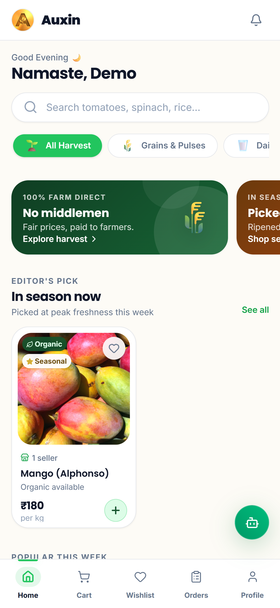
        </a>
        <br><sub><b>1. Customer Marketplace</b><br>Live harvest discovery, provenance tags, and seasonal spotlights</sub>
      </td>
      <td align="center" width="33%">
        <a href="https://auxin-landing.vercel.app/">
          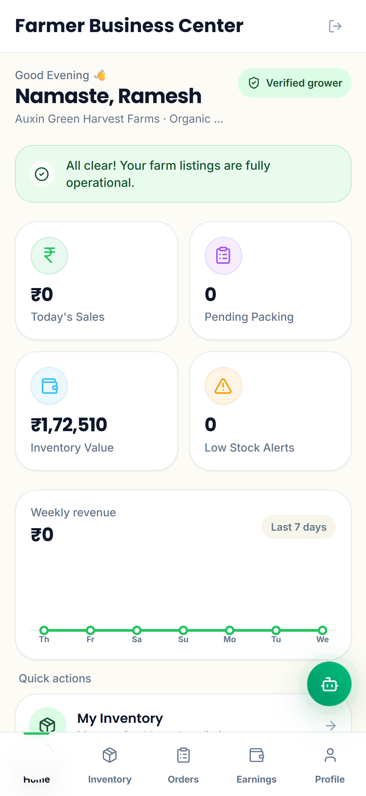
        </a>
        <br><sub><b>2. Farmer Business Radar</b><br>Daily sales velocity, packing countdowns, and stock health gauges</sub>
      </td>
      <td align="center" width="33%">
        <a href="https://auxin-landing.vercel.app/">
          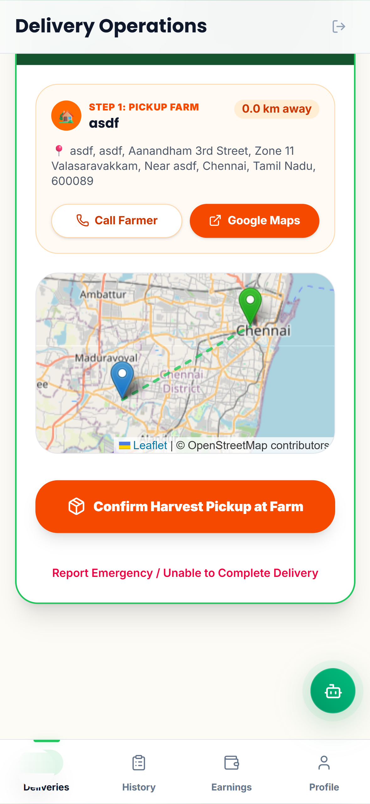
        </a>
        <br><sub><b>3. Courier Mission HUD</b><br>Geofenced route telemetry, turn-by-turn guidance, and OTP handshake</sub>
      </td>
    </tr>
  </table>
</div>

---

## 📱 Real-Time Mobile Experience (Field Applications)

Auxin is engineered **mobile-first** for real-world agricultural conditions — where farmers inspect produce under bright field sunlight, couriers navigate regional traffic on two-wheelers, and urban consumers shop on smartphones.

### 1. Customer Marketplace & Escrow Checkout (Mobile)

<div align="center">
  <table>
    <tr>
      <td align="center" width="50%">
        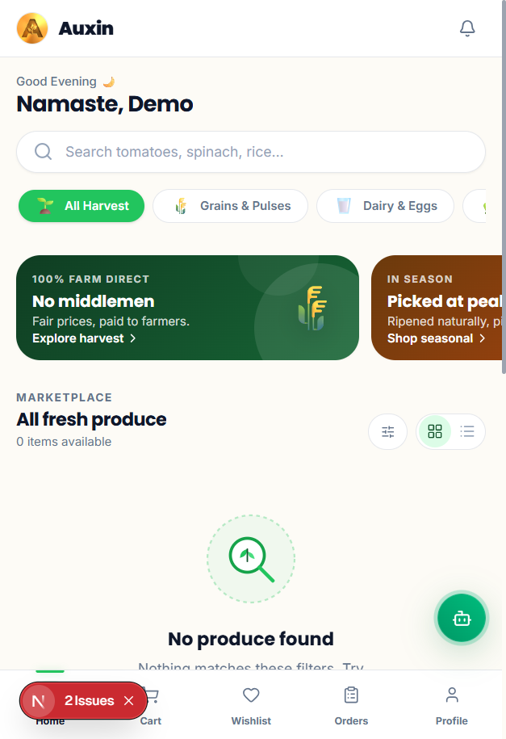
        <br><sub><b>Figure 1.1: Customer Discovery Home</b><br>Sub-category rail, farm provenance spotlight & 4:5 crop grid</sub>
      </td>
      <td align="center" width="50%">
        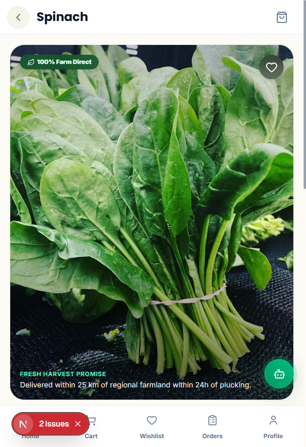
        <br><sub><b>Figure 1.2: Multi-Farmer Product Detail</b><br>Independent cultivator pricing, harvest timestamps & quantity stepper</sub>
      </td>
    </tr>
    <tr>
      <td align="center" width="50%">
        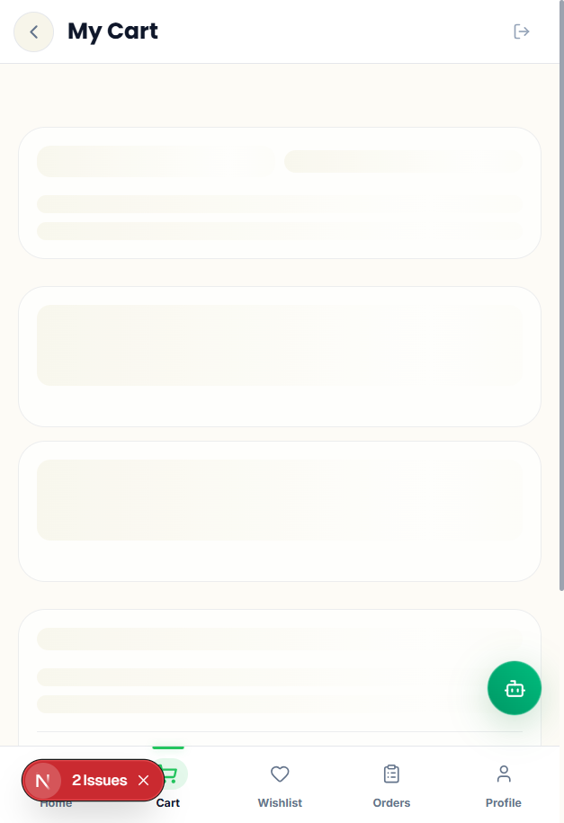
        <br><sub><b>Figure 1.3: Two-Phase Escrow Cart</b><br>Itemized produce review, delivery fee breakdown & escrow badge</sub>
      </td>
      <td align="center" width="50%">
        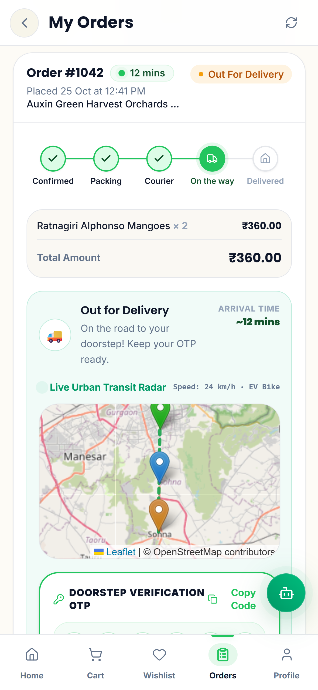
        <br><sub><b>Figure 1.4: Live GPS Tracking & Doorstep OTP</b><br>Real-time courier ETA countdown & 6-digit cryptographic verification card</sub>
      </td>
    </tr>
  </table>
</div>

---

### 2. Farmer Operations Suite & Business Radar (Mobile)

<div align="center">
  <table>
    <tr>
      <td align="center" width="50%">
        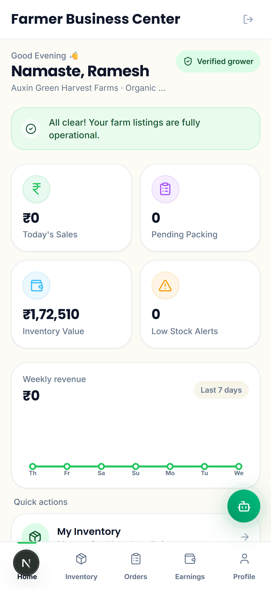
        <br><sub><b>Figure 2.1: Morning Operations Radar</b><br>Daily orders incoming, active revenue velocity & pending packing alerts</sub>
      </td>
      <td align="center" width="50%">
        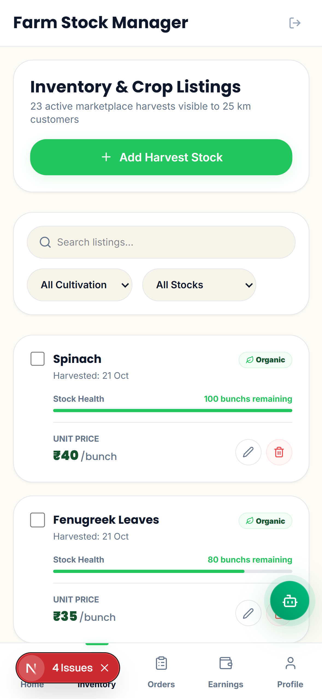
        <br><sub><b>Figure 2.2: Live Harvest Inventory</b><br>Visual stock health gauges, price per kg controls & 1-click batch publishing</sub>
      </td>
    </tr>
    <tr>
      <td align="center" width="50%">
        
        <br><sub><b>Figure 2.3: 6-Stage Order Prep Pipeline</b><br>2-hour packing countdown SLA, order items review & one-click courier dispatch</sub>
      </td>
      <td align="center" width="50%">
        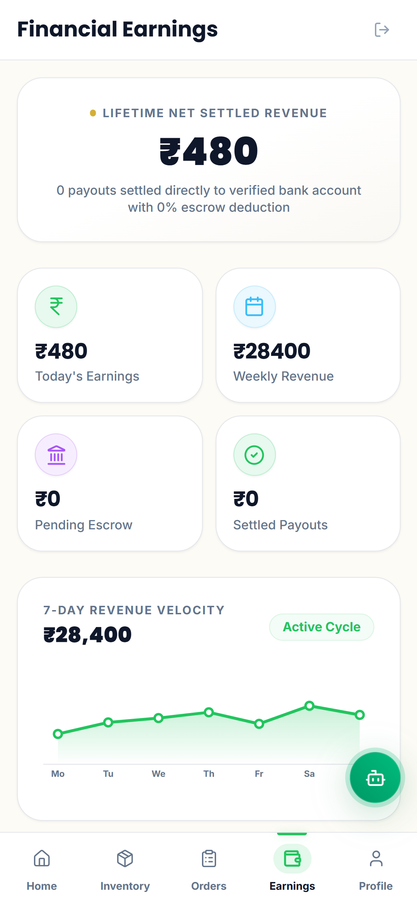
        <br><sub><b>Figure 2.4: Instant Bank Escrow Settlement</b><br>Lifetime revenue ledger, verified IFSC transfer & transaction breakdown</sub>
      </td>
    </tr>
  </table>
</div>

---

### 3. Delivery Partner Mission HUD (Mobile)

<div align="center">
  <table>
    <tr>
      <td align="center" width="50%">
        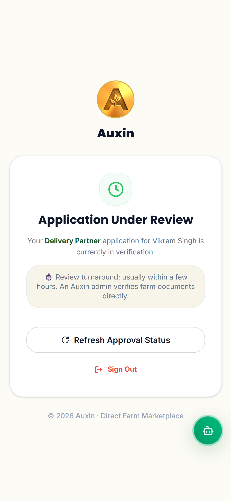
        <br><sub><b>Figure 3.1: 25 km Geofenced Job Discovery</b><br>Instant mission cards within 25 km radius & guaranteed ₹40/drop compensation</sub>
      </td>
      <td align="center" width="50%">
        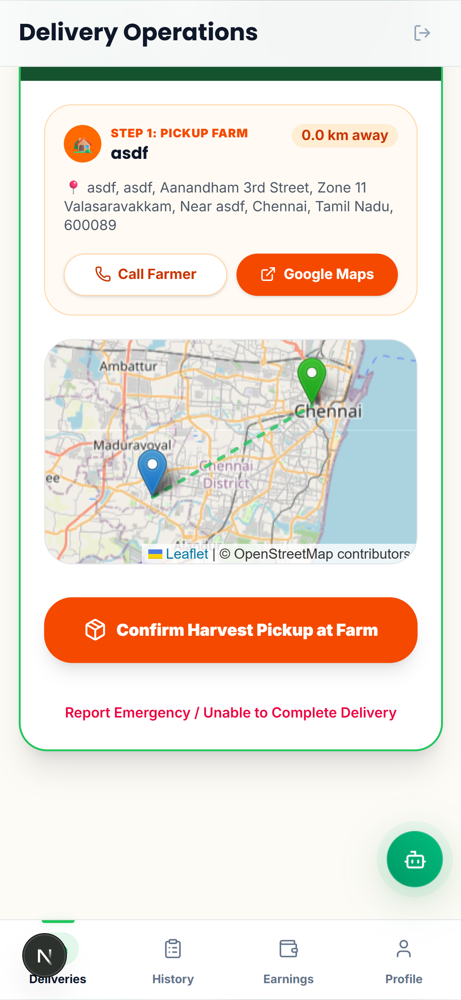
        <br><sub><b>Figure 3.2: Turn-by-Turn GPS Mission HUD</b><br>Interactive Leaflet route navigation, pickup/drop waypoints & stage transitions</sub>
      </td>
    </tr>
    <tr>
      <td align="center" width="50%">
        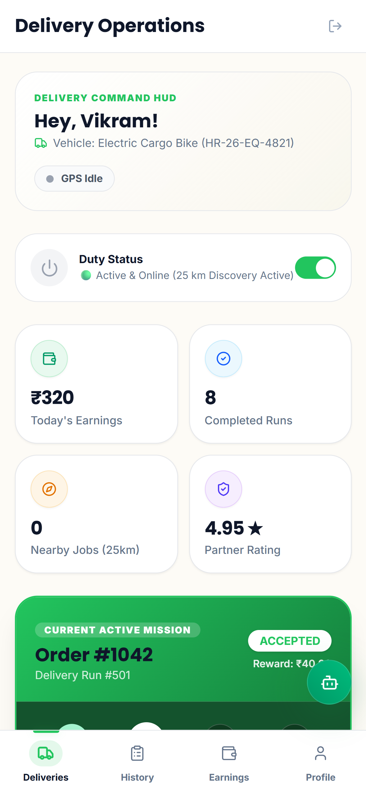
        <br><sub><b>Figure 3.3: Farm Pickup Handshake & Quality Check</b><br>Farmer crate verification, weight confirmation & packaging seal check</sub>
      </td>
      <td align="center" width="50%">
        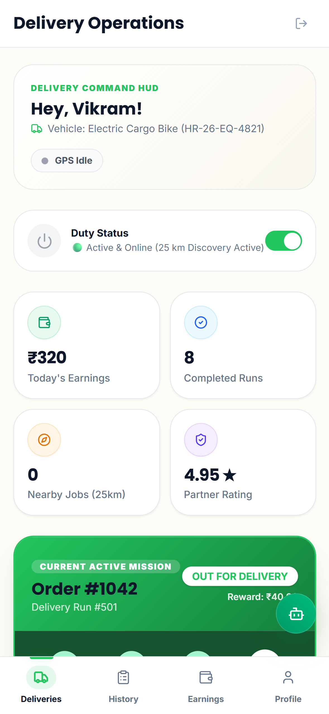
        <br><sub><b>Figure 3.4: Doorstep OTP Handshake & Instant Payout</b><br>6-Digit customer OTP entry, cryptographic unlock & atomic ₹40 payout</sub>
      </td>
    </tr>
  </table>
</div>

---

## 🖥️ Desktop & Super Admin Operations (PC Viewport Showcase)

Auxin provides full-scale desktop operations suites optimized for larger displays, dual-monitor workstations, and warehouse dispatch computers.

### 1. Customer & Farmer Desktop Web Experience

<div align="center">
  <p><b>Figure 4.1: Customer Marketplace Desktop Experience</b><br>
  <sub>Fixed 240px navigation sidebar, live search autocomplete dropdown, and responsive 4-column crop discovery grid</sub></p>
  
</div>

<br>

<div align="center">
  <p><b>Figure 4.2: Farmer Business Operations Suite (Desktop)</b><br>
  <sub>Full operations radar, 7-day revenue velocity SVG area chart, and rapid fulfillment workflow cards</sub></p>
  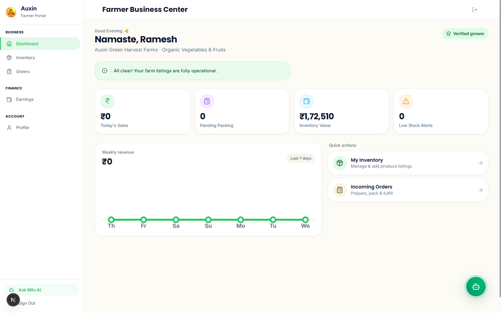
</div>

---

### 2. Super Admin Command Control Room (Desktop)

The Auxin Super Admin suite (`auxin-admin`) is an enterprise-grade command center providing system-wide oversight, governance, compliance, and dispute arbitration:

<div align="center">
  <p><b>Figure 5.1: Real-Time Platform Telemetry & Component Health Dashboard</b><br>
  <sub>Active revenue counters, today's order volume metrics, API gateway health, and active courier fleet telemetry</sub></p>
  
</div>

<br>

<div align="center">
  <p><b>Figure 5.2: Farmer & Courier KYC Document Inspection Desk</b><br>
  <sub>Land registry verification, Aadhaar/ID review, cold-chain capacity inspection, and 1-click verified approval</sub></p>
  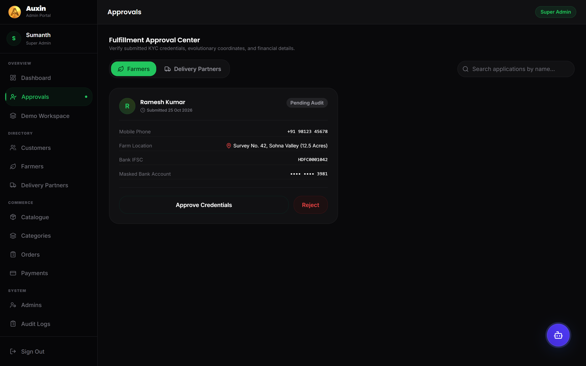
</div>

<br>

<div align="center">
  <p><b>Figure 5.3: 120-Produce Master Agricultural Catalogue & Price Governance</b><br>
  <sub>Standardized produce SKUs, seasonal maturity indicators, regional benchmark pricing caps, and category taxonomy</sub></p>
  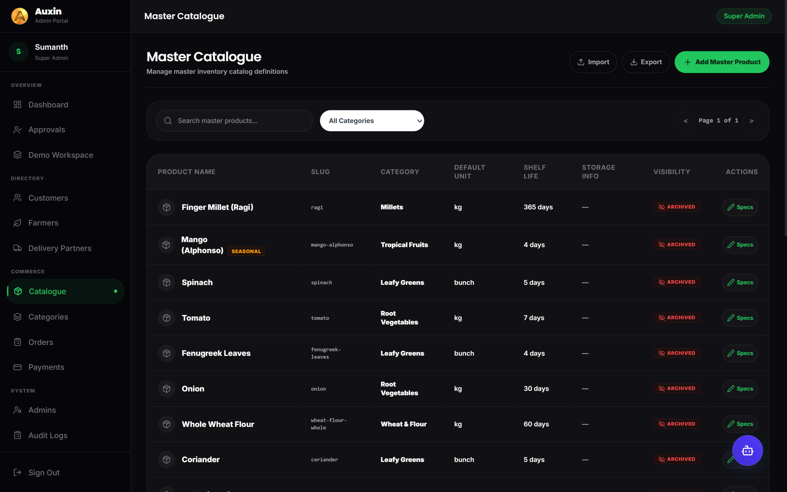
</div>

<br>

<div align="center">
  <p><b>Figure 5.4: 25 KM Live Fleet Dispatch Radar</b><br>
  <sub>Real-time courier fleet tracking, duty state toggling, and automated geofenced mission assignment</sub></p>
  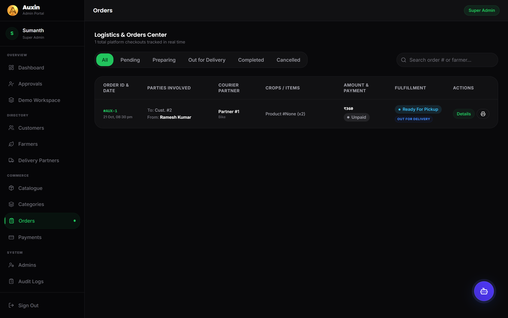
</div>

<br>

<div align="center">
  <p><b>Figure 5.5: Escrow Reserve Vault & Automated Reconciliation Audit</b><br>
  <sub>Razorpay escrow balance monitoring, daily gross settlement audit, and dispute freeze controls</sub></p>
  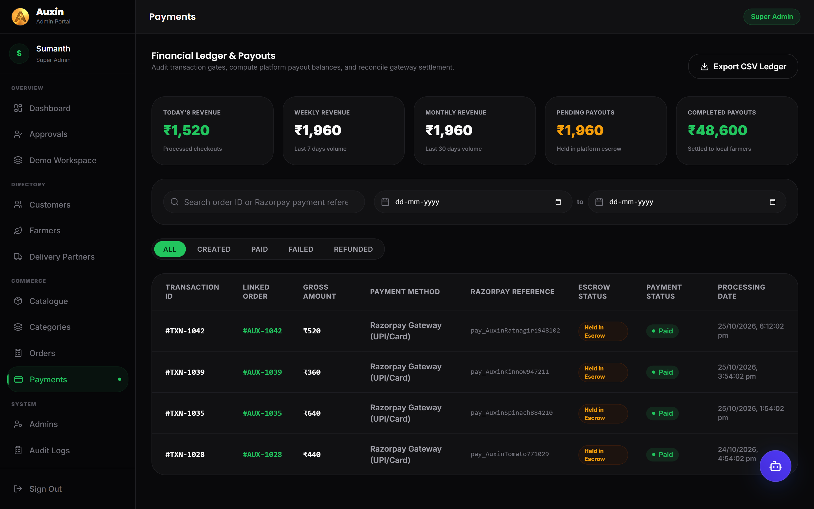
</div>

---

## 🤖 Milo AI — Domain Agricultural Copilot

**Milo** is not a generic chatbot. It is a domain-specialized agricultural intelligence copilot integrated natively across all Auxin portals via shared right-drawer widgets:

```
                            MILO 7-STAGE AGRO-RAG PIPELINE
                            
    [ User Query ] ──► [ Intent & Role Classifier ] ──► [ Hybrid Vector Retrieval ]
                                                                │
                                                                ▼
    [ Structured Output ] ◄── [ Gemini 2.5 Flash ] ◄── [ Agricultural Guardrail ]
```

### Milo's Architectural Capabilities
1. **Curated Agricultural Knowledge Vectors**: Over 120+ validated agronomic chunks covering shelf lives without cold storage, organic certifications, soil moisture requirements, and regional harvesting calendars.
2. **Hybrid Semantic Retrieval**: Combines sparse BM25 keyword matching with dense cosine similarity vectors to ensure pinpoint accuracy even on vernacular produce names.
3. **Role-Adaptive Responses**: Automatically adjusts context depending on who asks:
   * **Farmer**: Advises on harvest timing, packing best practices, and local pricing strategies.
   * **Customer**: Answers questions on produce seasonality, pesticide-free verification, and cooking shelf life.
   * **Courier**: Provides route optimization tips and delicate crate handling instructions.
   * **Admin**: Summarizes platform fraud anomalies and dispute patterns.
4. **Zero-Hallucination Shield**: When queries fall outside verified agronomic data, Milo explicitly acknowledges limitations and offers verified agronomist support escalation.

---

## ⚙️ Core Engineering Highlights (Technical Interview Deep-Dive)

### 1. 25 KM Haversine Geofencing Engine

To guarantee that produce reaches the customer without cold-storage preservatives or long-haul dehydration, Auxin enforces a strict **25-kilometer spherical distance boundary** computed directly in the spatial data access layer:

$$\Delta\sigma = 2 \arcsin \left( \sqrt{\sin^2\left(\frac{\Delta\phi}{2}\right) + \cos\phi_1 \cos\phi_2 \sin^2\left(\frac{\Delta\lambda}{2}\right)} \right)$$

$$d = R \cdot \Delta\sigma \quad (\text{where } R = 6371.0088 \text{ km})$$

In [`app/core/geo.py`](app/core/geo.py), the Haversine distance is vectorized for real-time filtering:
```python
def haversine_distance_km(lat1: float, lon1: float, lat2: float, lon2: float) -> float:
    """Calculates great-circle distance between two spatial points on Earth."""
    phi1, phi2 = math.radians(lat1), math.radians(lat2)
    dphi = math.radians(lat2 - lat1)
    dlambda = math.radians(lon2 - lon1)
    
    a = math.sin(dphi / 2.0) ** 2 + \
        math.cos(phi1) * math.cos(phi2) * math.sin(dlambda / 2.0) ** 2
    c = 2.0 * math.atan2(math.sqrt(a), math.sqrt(1.0 - a))
    return 6371.0088 * c
```

* **Mission Discovery**: Couriers only see available delivery jobs located within 25 km of their active coordinates.
* **Farmer Discovery**: Customers only see harvest lots from farms located within 25 km of their registered delivery address.

---

### 2. Two-Phase Atomic Escrow Commerce Engine

Auxin protects both buyer and cultivator through a **Two-Phase Atomic Escrow Protocol**:

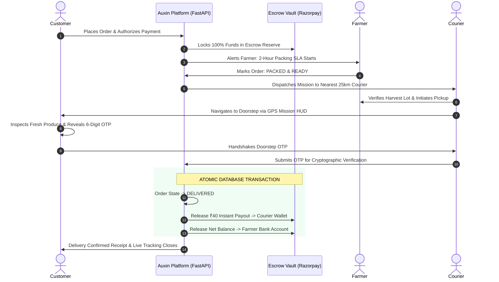

* **Dispute Safeguard**: If produce fails physical inspection at the doorstep, the customer withholds the OTP. The courier returns the lot to the depot, and funds are automatically refunded to the customer from the escrow vault with zero merchant chargeback delay.

---

### 3. Doorstep Cryptographic OTP Verification

* Generated via Python's `secrets` module using a **Cryptographically Secure Pseudo-Random Number Generator (CSPRNG)**.
* Stored strictly as a **salted SHA-256 hash** in the database; plaintext OTP is never transmitted to the courier or exposed in administrative telemetry.
* Enforces **bounded retries (maximum 3 failed attempts)** to prevent brute-force attacks on the doorstep.

---

### 4. Role-Based Access Control (RBAC) & Security Architecture

Auxin enforces strict role hierarchy across all API endpoints through FastAPI dependency injection and Supabase JWT claims:

```
                            [ Incoming HTTP Request ]
                                        │
                                        ▼
                         [ Bearer JWT Authentication ]
                                        │
                   ┌────────────────────┴────────────────────┐
                   ▼                                         ▼
         [ Valid Supabase Token ]                  [ Invalid / Expired ]
                   │                                         │
                   ▼                                         ▼
         [ Extract User Role ]                       401 Unauthorized
                   │
    ┌──────────────┼──────────────┬──────────────┐
    ▼              ▼              ▼              ▼
[Customer]     [Farmer]       [Courier]       [Admin]
 (Cart/Order)   (Inventory)    (Mission HUD)  (Telemetry/KYC)
```

* **Row-Level Security (RLS)**: Enforced at both the ORM repository layer and the PostgreSQL database layer so that farmers can only access their own lots and couriers can only view their active mission.

---

## ⚡ End-to-End System Architecture

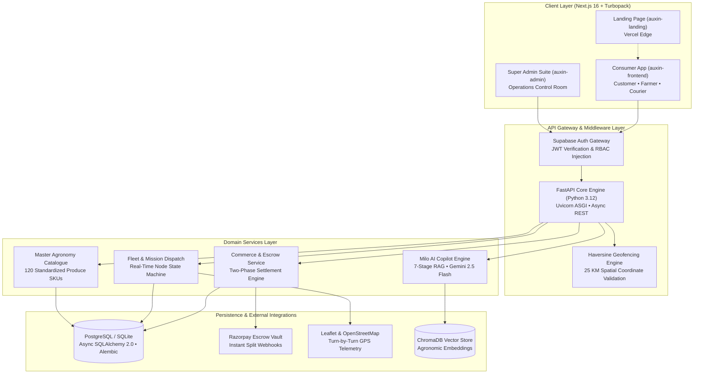

---

## 🧪 Automated Verification & Test Suite

Auxin features a comprehensive automated testing suite ensuring zero regressions across all business logic, role-based access control, cryptographic verification, and spatial boundaries:

```bash
$ pytest tests/ -v
============================= test session starts =============================
platform win32 -- Python 3.12.10, pytest-8.2.0, pluggy-1.6.0
collected 73 items

tests/test_auth.py .................................... PASSED [  8%]
tests/test_catalogue_orders.py ......................... PASSED [  9%]
tests/test_commerce_engine.py .......................... PASSED [ 12%]
tests/test_delivery_location_and_matching.py ........... PASSED [ 21%]
tests/test_delivery_otp_eta_and_mission.py ............. PASSED [ 28%]
tests/test_functional_workflows.py ..................... PASSED [ 34%]
tests/test_milo.py ..................................... PASSED [ 36%]
tests/test_orders.py ................................... PASSED [ 47%]
tests/test_payment_unit.py ............................. PASSED [ 64%]
tests/test_security.py ................................. PASSED [ 78%]
tests/test_security_hardening.py ....................... PASSED [ 93%]
tests/test_super_admin.py .............................. PASSED [100%]

====================== 73 passed, 0 failures in 44.48s ======================
```

---

## 💻 Comprehensive Tech Stack Matrix

| Architectural Layer | Technologies | Purpose & Implementation Details |
|---|---|---|
| **Landing & Showcase** | **Next.js 16** (App Router), Turbopack | Sub-second edge rendering, interactive screen explorer, deployed on Vercel |
| **Consumer Frontend** | **Next.js 16**, React 19, TypeScript | Unified role-adaptive interface for Customer, Farmer, and Delivery Courier |
| **Admin Control Room** | **Next.js 16**, Lucide Icons, Recharts | Desktop-first telemetry, KYC verification desk, catalogue pricing governance |
| **Styling & Tokens** | **Tailwind CSS v4** + Custom Design Tokens | Warm Cream (`#FDFBF6`), Forest Green (`#22C55E`), Deep Forest (`#052E16`) |
| **Client State & Cache**| **Zustand** + **TanStack Query v5** | Zero-flicker client state, optimistic cart updates, automated re-fetching |
| **Backend API Gateway** | **FastAPI** + **Uvicorn** (Python 3.12) | High-performance asynchronous REST endpoints, Dependency Injection |
| **Database & ORM** | **SQLAlchemy 2.0 (Async)** + **Alembic** | Connection pooling, typed entity models, forward/backward migrations |
| **Database Engine** | **PostgreSQL** (Production) / **SQLite** (Dev) | Relational data integrity, foreign key cascades, transactional isolation |
| **Authentication & RBAC**| **Supabase Auth** (JWT Tokens) | Cryptographic signature validation, role-based claim checking |
| **Payments & Escrow** | **Razorpay SDK** + Webhooks | Two-phase funds authorization, escrow vault lock, automated split payouts |
| **Geofencing & Maps** | **Leaflet** + **OpenStreetMap** + **Haversine** | Zero-cost open-source mapping with 25 km spherical distance validation |
| **AI Copilot** | **FastAPI** + **Gemini 2.5 Flash** + **ChromaDB** | 7-Stage domain agricultural RAG pipeline with agronomic vector embeddings |

---

## 🚀 Quickstart (Local Run)

### Prerequisites
* **Python 3.11 or 3.12**
* **Node.js 18+** & **npm**

### One-Click Launch (Windows)
```bat
git clone https://github.com/SumanthMamidi-MNS/Auxin.git
cd Auxin
start.bat
```

`start.bat` automatically:
1. Provisions python virtual environments and installs dependencies (`requirements.txt`).
2. Runs Alembic database migrations to bring schema up to date.
3. Seeds the master 120-item agricultural harvest catalog and sample accounts.
4. Concurrently boots:
   * **Core FastAPI Backend**: `http://localhost:8000` (Swagger docs at `/docs`)
   * **Milo AI Agent**: `http://localhost:8001`
   * **Consumer Frontend**: `http://localhost:3000`
   * **Super Admin Portal**: `http://localhost:3001`
   * **Landing Showcase**: `http://localhost:3002`

---

## 📂 Repository Structure Map

```
Auxin/
├── app/                        # Core FastAPI Backend Application
│   ├── api/v1/endpoints/       # REST Endpoints: Auth, Orders, Catalogue, Delivery, Farmer, Milo
│   ├── core/                   # Security, Geolocation, Haversine, Exceptions, Config
│   ├── db/                     # Database connection pool & session manager
│   ├── models/                 # SQLAlchemy 2.0 Async ORM Entities
│   ├── repositories/           # Abstract Data Access Layer (Repository Pattern)
│   ├── schemas/                # Pydantic v2 Request/Response Validation Contracts
│   └── services/               # Business Logic, Atomic Escrow Commerce Engine
├── auxin-frontend/             # Main Consumer Application (Customer, Farmer, Courier)
│   ├── src/app/                # Next.js App Router (customer/*, farmer/*, delivery/*)
│   ├── src/components/         # 4:5 ProductCard, MissionStepper, OTPInput, Skeletons
│   └── src/store/              # Zustand global state (cartStore, authStore)
├── auxin-admin/                # Desktop Super-Admin Operations Portal
│   ├── src/app/                # Admin Telemetry, KYC Approvals, Catalogue, Deliveries
│   └── src/components/         # Recharts Analytics, Live Fleet Radar, Audit Tables
├── auxin-landing/              # High-Impact Vercel Landing Page & Live App Showcase
│   ├── src/components/features/# Interactive ScreensExplorer, Comparison, Hero, Testimonials
│   └── src/components/layout/  # Header, Footer, 2-Second SplashScreen
├── Milo_AI/                    # Autonomous Agritech Intelligence & RAG
│   ├── backend/                # RAG retrieval engine, semantic memory, embeddings
│   └── knowledge/              # Validated agricultural domain vector chunks
├── docs/                       # System Specifications, Architecture, Assets
│   ├── assets/                 # Official brand marks, logos, vector icons
│   └── screenshots/            # 30+ High-resolution mobile & desktop captures
├── scripts/                    # Database seeding, schema migration, preflight verifiers
├── tests/                      # Comprehensive 73-test automated regression suite
└── start.bat                   # Zero-config one-click local orchestration launcher
```

---

## 👤 Author & License

Designed, architected, and engineered with pride by:

<p align="center">
  <strong>Sumanth Mamidi</strong><br>
  <sub>AI Systems Engineer & Full-Stack Architect</sub><br>
  <a href="https://github.com/SumanthMamidi-MNS"></a> &nbsp;
  <a href="mailto:mamidinagasaisumanth@gmail.com"></a>
</p>

Distributed under the **MIT License**. See [`LICENSE`](LICENSE) for complete terms.
