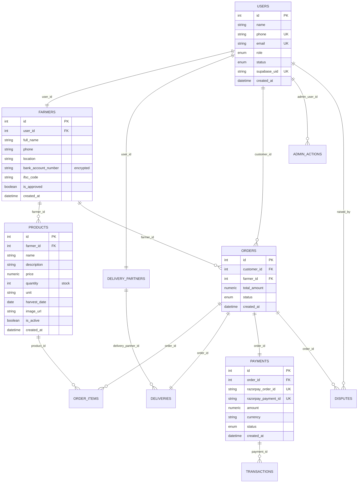

# Auxin v2.0 — System Architecture & Design Guide

This document defines the system architecture, file structures, database relationships, and third-party integrations for the Auxin v2.0 platform.

---

## 📂 Codebase Folder Structure

The Auxin codebase is organized as a monorepo containing the backend API, the user-facing frontend, the admin dashboard, and platform configurations.

```
The Auxin/
├── alembic/                    # SQLAlchemy database migrations
│   └── versions/               # Migrations (001_initial to 006_add_user_status)
├── app/                        # FastAPI Backend Application
│   ├── api/                    # API Routing and Endpoints
│   │   └── v1/
│   │       ├── endpoints/      # Controllers (auth, farmers, admin, payments, etc.)
│   │       └── router.py       # Global router & central exception handling
│   ├── core/                   # System config, dependencies, logging, and security
│   ├── db/                     # SQLAlchemy session setup & database base classes
│   ├── models/                 # SQLAlchemy Declarative Models (DB schemas)
│   ├── repositories/           # Database Query layer (Data Access Objects)
│   ├── schemas/                # Pydantic Schemas (Request/Response validation)
│   └── services/               # Core Business Logic (transfers, calculations, rules)
├── auxin-frontend/             # Customer, Farmer, and Delivery Frontend (Next.js 14)
│   ├── public/                 # Static assets
│   └── src/
│       ├── app/                # App Router (layouts, pages, error handlers)
│       ├── components/         # Reusable UI elements (inputs, drawers, cards)
│       ├── lib/                # API wrappers, Axios clients, and Supabase config
│       ├── store/              # Zustand global state (cart, auth, app state)
│       └── types/              # TypeScript typings
├── auxin-admin/                # Platform Governance Admin Portal (Next.js 14)
│   └── src/
│       ├── app/                # App Router (dashboard, disputes, user moderation)
│       ├── components/         # Admin sidebar, layout wrappers, and charts
│       ├── lib/                # Admin client and Supabase auth helpers
│       └── store/              # Zustand auth states
├── main.py                     # FastAPI application entry point
├── requirements.txt            # Python dependencies
└── render.yaml                 # Infrastructure-as-code template for Render
```

---

## ⚙️ Backend Architecture (FastAPI + SQLAlchemy)

The backend is built with FastAPI following a clean repository-service-controller pattern.

```
[ HTTP Client Request ]
         │
         ▼
[ API Controller (Endpoints) ]  <--- Validates inputs using Pydantic Schemas
         │
         ▼
[ Core Service Layer ]          <--- Enforces business rules (escrow, statuses, transitions)
         │
         ▼
[ Repository Layer ]            <--- Executes query logic via SQLAlchemy async sessions
         │
         ▼
[ PostgreSQL Database (Neon) ]
```

### Key Middlewares (in `main.py`):
1.  **`SecurityHeadersMiddleware`**: Injects headers (`X-Frame-Options`, `Content-Security-Policy`, `X-Content-Type-Options`) into all responses.
2.  **`RequestLoggingMiddleware`**: Capture request execution time and outputs structured JSON logs.
3.  **`CORSMiddleware`**: Restricts incoming requests to domains specified in the `ALLOWED_ORIGINS` environment variable.

---

## 🎨 Frontend & Admin Architecture (Next.js 14)

Both frontends utilize Next.js 14 (App Router) combined with modern styling and state tools:
*   **Styling:** Custom Vanilla Tailwind CSS configurations for high-fidelity dark styling.
*   **State Management:** Zustand stores with `persist` middleware for session persistence.
*   **API Queries:** React Query (`@tanstack/react-query`) handles caching, auto-refetching, and state synchronization.
*   **Resilience (Render Wake-Up):** Axios request interceptor detects HTTP 503 or connection timeout (Render free-tier sleep). It sets `isColdStart=true` in `appStore` to show an animated skeleton loading screen and schedules a retry 3 seconds later.

---

## 🗄️ Supabase Auth & JWT Verification

Auxin v2.0 integrates Supabase Auth for identity management.

1.  **Synthetic Email Mapping:**
    Because Supabase Auth relies on email/password combinations, Auxin converts the user's mobile number into a deterministic synthetic email on sign-in/up:
    $$\text{Phone} \xrightarrow{\text{phoneToEmail()}} \text{Phone} + \text{"@auxin.app"}$$
    *Example:* `+919876543210` becomes `+919876543210@auxin.app`.
2.  **JWT Verification:**
    When the client makes a backend request, it includes the Supabase Auth access token in the `Authorization: Bearer` header. The backend validates this token against the `SUPABASE_JWT_SECRET` key using PyJWT/python-jose:
    ```python
    payload = jwt.decode(token, SUPABASE_JWT_SECRET, algorithms=["HS256"], audience="authenticated")
    ```
    If valid, the backend maps the token's `sub` claim (Supabase UUID) to the `supabase_uid` column in the `users` table.

---

## 💳 Razorpay Escrow Payments Integration

Funds are managed securely using an Escrow model:

```
[ Cart Checkout ] 
       │
       ▼
[ POST /payments/create ] ──► Backend generates Razorpay Order ID
       │
       ▼
[ Client payment verified ] ──► Client calls POST /payments/verify
       │
       ▼
[ Backend signature check ] ──► Set payment.status = 'paid' (Held in Escrow)
       │
       ▼
[ Delivery geofence handoff ] ──► OTP verification success
       │
       ▼
[ RELEASE Escrow Funds ] ──► Transaction table logs 'release' payment to farmer
```

*   **ESCROW State:** Set when `payment.status = 'paid'`.
*   **RELEASE State:** Triggered when the courier enters the correct handoff OTP. The backend logs a transaction of type `release` and records the transfer of funds to the farmer.
*   **REFUND State:** Triggered if the order is cancelled or rejected. The admin (or farmer reject callback) requests `POST /payments/refund`. The Razorpay API reverses the transaction, and `payment.status` is updated to `refunded`.

---

## 📊 Database Relationships (Neon PostgreSQL)



---

## 🛡️ Role System & Administrative Governance

### Lifecycles

#### User Account Statuses
*   `pending`: Account registered, awaiting validation (farmers and delivery partners only).
*   `approved`: Account active. Permitted to browse, list, or fulfill orders.
*   `rejected`: Approval request denied. Login is blocked.
*   `suspended`: Blocked by administrator due to disputes or audit reviews.

#### Order Statuses
*   `pending` ➡️ `accepted` (Accepted by Farmer) or `rejected` (Rejected by Farmer, triggers refund) or `cancelled` (Cancelled by Customer, triggers refund).
*   `accepted` ➡️ `completed` (Fulfillment OTP verified).

#### Dispute Statuses
*   `open` ➡️ `in_review` ➡️ `resolved` (Admins can check `trigger_refund=true` to reimburse the customer) or `rejected` (Dispute dismissed; funds remain settled).
